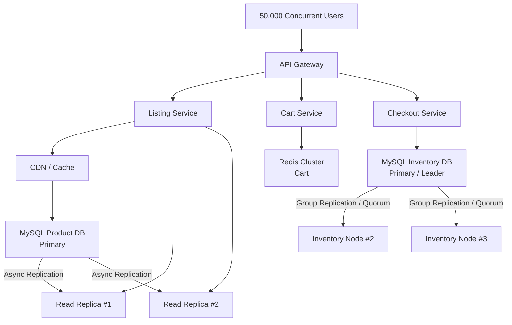

# PACELC Flash Sale System

## 1. PACELC Classification

Hệ thống Flash Sale phục vụ khoảng **50,000 concurrent users**.
Mỗi luồng có yêu cầu về Consistency, Availability và Latency khác nhau nên không áp dụng một chiến lược PACELC duy nhất cho toàn hệ thống.

### 1.1 Listing Stock → PA/EL

| PACELC    | Lựa chọn              |
| --------- | --------------------- |
| Partition | **Availability (PA)** |
| Else      | **Latency (EL)**      |

**Giải thích:**

- **Partition → Availability (PA):** Khi xảy ra network partition, hệ thống vẫn ưu tiên trả dữ liệu cho người dùng thay vì từ chối request.
- **Else → Latency (EL):** Khi hệ thống hoạt động bình thường, ưu tiên trả dữ liệu nhanh để phục vụ lượng request lớn.

**Vì sao chọn PA/EL?**

Dữ liệu stock trên trang Listing chỉ mang tính chất **hiển thị**. Dữ liệu này có thể bị stale trong một khoảng thời gian ngắn do `Read Replica` có replication lag.

Ví dụ:

```text
Listing hiển thị: Còn 5 sản phẩm
Thực tế Inventory: Còn 2 sản phẩm
```

Trường hợp này có thể chấp nhận được vì Listing **không phải nguồn dữ liệu cuối cùng để quyết định việc mua hàng**.

Khi người dùng Checkout, hệ thống phải kiểm tra lại stock từ `Inventory Database` với consistency cao.

---

### 1.2 Add-to-cart → PA/EL

| PACELC    | Lựa chọn              |
| --------- | --------------------- |
| Partition | **Availability (PA)** |
| Else      | **Latency (EL)**      |

**Giải thích:**

- **Partition → Availability (PA):** Cart vẫn cần hoạt động ngay cả khi một phần hệ thống gặp sự cố.
- **Else → Latency (EL):** Add-to-cart cần phản hồi rất nhanh vì đây là thao tác xảy ra thường xuyên trong Flash Sale.

**Vì sao chọn PA/EL?**

Cart không phải nguồn dữ liệu quyết định stock cuối cùng.

Có thể xảy ra trường hợp nhiều user cùng thêm một sản phẩm vào Cart:

```text
User A → Add Product X
User B → Add Product X
User C → Add Product X
...
```

Điều này không đồng nghĩa với việc hệ thống đã giữ hàng cho từng user.

Stock thực tế chỉ được xác nhận tại bước `Checkout`.

Vì vậy, Cart ưu tiên:

- High Availability
- Low Latency
- High Throughput

---

### 1.3 Checkout → PC/EC

| PACELC    | Lựa chọn             |
| --------- | -------------------- |
| Partition | **Consistency (PC)** |
| Else      | **Consistency (EC)** |

**Giải thích:**

- **Partition → Consistency (PC):** Khi xảy ra network partition, hệ thống phải ưu tiên dữ liệu stock chính xác và có thể từ chối request nếu không đảm bảo consistency.
- **Else → Consistency (EC):** Ngay cả khi hệ thống hoạt động bình thường, Checkout vẫn ưu tiên consistency thay vì latency.

**Vì sao chọn PC/EC?**

Checkout là luồng quan trọng nhất vì đây là nơi quyết định user có mua được sản phẩm hay không.

Hệ thống phải đảm bảo:

```text
Stock = 1

User A → Checkout → Success
User B → Checkout → Sold Out
```

Không được xảy ra:

```text
Stock = 1

User A → Success
User B → Success

=> Overselling ❌
```

Do đó Checkout phải sử dụng `Inventory Database` làm **Source of Truth** và không được sử dụng dữ liệu stale từ `Read Replica` để quyết định trừ stock.

---

## 2. Database & Topology

### 2.1 Listing Stock

**Database: MySQL**

Topology:

```text
                 ┌───────────────┐
                 │ MySQL Primary │
                 └───────┬───────┘
                         │
                Async Replication
                         │
              ┌──────────┴──────────┐
              ▼                     ▼
       ┌─────────────┐       ┌─────────────┐
       │ Read Replica│       │ Read Replica│
       │     #1      │       │     #2      │
       └─────────────┘       └─────────────┘
```

Listing chủ yếu đọc dữ liệu nên request có thể được phân phối sang `Read Replica`.

**Đặc điểm:**

- `Primary`: xử lý write.
- `Read Replica`: xử lý read.
- `Async Replication`: replica có thể trễ một khoảng thời gian.
- Có thể kết hợp `Cache/CDN` để giảm lượng request trực tiếp vào Database.

**Lưu ý quan trọng:**

`Read Replica` chỉ phục vụ Listing.

Không sử dụng Listing Replica để quyết định Checkout.

---

### 2.2 Add-to-cart

**Database: Redis Cluster**

Topology:

```text
             ┌──────────────┐
             │ Cart Service │
             └───────┬──────┘
                     │
              ┌──────▼──────┐
              │ Redis Cluster│
              └─────────────┘
```

Redis phù hợp với Cart vì:

- Low Latency
- High Throughput
- Hỗ trợ lượng request lớn.
- Có thể scale horizontally.
- Không yêu cầu Cart phải là nguồn dữ liệu stock cuối cùng.

Cart có thể lưu:

```text
userId
productId
quantity
```

---

### 2.3 Checkout / Inventory

**Database: MySQL**

Đối với Inventory, ưu tiên mô hình có consistency cao, sử dụng `MySQL Group Replication / InnoDB Cluster` với cơ chế quorum để đảm bảo dữ liệu stock không bị ghi nhận sai khi có failure.

Topology:

```text
                  ┌─────────────────────┐
                  │ Inventory DB Primary│
                  └──────────┬──────────┘
                             │
                    Synchronous /
                    Group Replication
                             │
                 ┌───────────┴───────────┐
                 ▼                       ▼
          ┌─────────────┐        ┌─────────────┐
          │ Inventory   │        │ Inventory   │
          │ Node #2     │        │ Node #3     │
          └─────────────┘        └─────────────┘
```

Inventory là **Source of Truth** cho stock.

Checkout phải sử dụng database path có consistency cao và không dựa vào dữ liệu stale từ Listing.

---

## 3. Configuration / Knobs

### 3.1 Listing Stock

Các lựa chọn chính:

```text
Read Strategy:
    Read from Replica

Replication:
    Async Replication

Consistency:
    Eventual Consistency

Optimization:
    Cache / CDN
```

Mục tiêu:

```text
High Availability
+
Low Latency
+
High Read Throughput
```

Một chút `Replication Lag` có thể chấp nhận được vì dữ liệu chỉ dùng để hiển thị.

---

### 3.2 Add-to-cart

Các lựa chọn chính:

```text
Storage:
    Redis Cluster

Consistency:
    Eventual Consistency

Optimization:
    In-memory access
    Horizontal Scaling
```

Mục tiêu:

```text
High Availability
+
Low Latency
+
High Throughput
```

Cart không quyết định stock cuối cùng.

---

### 3.3 Checkout

Các lựa chọn chính:

```text
Read/Write:
    Primary / Consistent Leader

Replication:
    Synchronous / Group Replication

Consistency:
    Strong Consistency

Transaction:
    Enabled

Inventory Update:
    Atomic Update

Retry:
    Idempotency-Key
```

Khi trừ stock, sử dụng `Atomic Update`:

```sql
UPDATE inventory
SET stock = stock - 1
WHERE product_id = ?
  AND stock > 0;
```

Sau đó kiểm tra số lượng record được update:

```text
affectedRows = 1
    → Reserve/Checkout thành công

affectedRows = 0
    → Stock đã hết
```

Điều kiện `stock > 0` giúp tránh việc nhiều request cùng giảm stock xuống giá trị âm.

---

## 4. System Architecture



### 4.1 Listing Flow

```text
User
 ↓
API Gateway
 ↓
Listing Service
 ↓
Cache / Read Replica
 ↓
Display Stock
```

Mục tiêu là giảm latency và tránh để lượng lớn user truy cập trực tiếp vào `Primary Database`.

---

### 4.2 Add-to-cart Flow

```text
User
 ↓
API Gateway
 ↓
Cart Service
 ↓
Redis Cluster
 ↓
Cart Updated
```

Cart được xử lý nhanh và không cần lock stock thật.

---

### 4.3 Checkout Flow

```text
User
 ↓
API Gateway
 ↓
Checkout Service
 ↓
Inventory DB
 ↓
Atomic Stock Update
 ↓
Create Order
```

Đây là flow yêu cầu consistency cao nhất.

---

## 5. Risks & Mitigation

### 5.1 Replication Lag

**Risk:**

`Read Replica` có thể chưa nhận được dữ liệu mới nhất từ `Primary`.

Ví dụ:

```text
Primary:
Stock = 2

Replica:
Stock = 5
```

Listing có thể hiển thị stock không chính xác trong thời gian ngắn.

**Mitigation:**

- Chấp nhận stale data ở Listing.
- Không dùng Replica để quyết định Checkout.
- Checkout luôn kiểm tra `Inventory Database`.
- Có thể sử dụng Cache/CDN để giảm tải cho Database.

---

### 5.2 Thundering Herd

**Risk:**

Trong Flash Sale, hàng chục nghìn user có thể gửi request cùng lúc.

Ví dụ:

```text
50,000 users
      ↓
50,000 requests
      ↓
Database
```

Nếu tất cả request đều đi thẳng vào Database, Database có thể trở thành bottleneck.

**Mitigation:**

- CDN.
- Application Cache.
- Redis.
- Read Replica.
- Horizontal Scaling.
- Rate Limiting.
- Request Throttling.

Mục tiêu:

```text
50,000 users
      ↓
Cache / Redis / Replica
      ↓
Chỉ một phần request đến Primary DB
```

---

### 5.3 Retry

**Risk:**

Request Checkout có thể timeout.

Client không biết request trước đó đã thành công hay chưa nên gửi lại request.

Ví dụ:

```text
Request #1
    ↓
Checkout
    ↓
Order created
    ↓
Network timeout
    ↓
Client không nhận được response

Client retry
    ↓
Request #2
```

Nếu không xử lý tốt, có thể tạo duplicate order.

**Mitigation:**

Sử dụng `Idempotency-Key`.

Ví dụ:

```http
Idempotency-Key: checkout-user123-product456-001
```

Các request retry với cùng `Idempotency-Key` phải được xem là cùng một logical request.

---

### 5.4 Idempotency

**Risk:**

Một logical Checkout request có thể được gửi nhiều lần do:

- Network timeout.
- Client retry.
- API Gateway retry.
- Message retry.

**Mitigation:**

Lưu `Idempotency-Key` cùng kết quả của request.

```text
Request
   ↓
Check Idempotency-Key
   ↓
Already processed?
   ├── Yes → Return existing result
   └── No  → Process Checkout
```

Điều này giúp tránh tạo nhiều Order cho cùng một thao tác Checkout.

---

### 5.5 Overselling

**Risk:**

Đây là rủi ro nghiêm trọng nhất của Flash Sale.

Ví dụ:

```text
Stock = 1

User A ──┐
         ├── Checkout cùng lúc
User B ──┘
```

Nếu hệ thống thực hiện:

```text
SELECT stock
```

sau đó mới:

```text
UPDATE stock
```

cả hai request có thể cùng nhìn thấy `stock = 1`.

Kết quả có thể dẫn đến:

```text
User A → Success
User B → Success

Overselling ❌
```

**Mitigation:**

Sử dụng `Atomic Update`:

```sql
UPDATE inventory
SET stock = stock - 1
WHERE product_id = ?
  AND stock > 0;
```

Chỉ request có:

```text
affectedRows = 1
```

mới được xem là trừ stock thành công.

Request còn lại:

```text
affectedRows = 0
```

→ trả về `Sold Out`.

---

## 6. PACELC Summary

| Flow          | Partition    | Else        | PACELC    | Priority         |
| ------------- | ------------ | ----------- | --------- | ---------------- |
| Listing Stock | Availability | Latency     | **PA/EL** | Fast & Available |
| Add-to-cart   | Availability | Latency     | **PA/EL** | Fast & Available |
| Checkout      | Consistency  | Consistency | **PC/EC** | Correctness      |

### Design Principle

```text
Listing
    → Có thể stale
    → Ưu tiên Availability + Low Latency

Cart
    → Không phải Source of Truth
    → Ưu tiên Availability + Low Latency

Checkout
    → Quyết định mua hàng
    → Inventory là Source of Truth
    → Ưu tiên Strong Consistency
    → Không được Overselling
```

**Kết luận:**

Không nên áp dụng một PACELC strategy cho toàn bộ hệ thống.

Trong Flash Sale, mỗi flow có mục tiêu khác nhau:

- `Listing Stock` → **PA/EL**
- `Add-to-cart` → **PA/EL**
- `Checkout` → **PC/EC**

Thiết kế này cho phép hệ thống phục vụ lượng lớn concurrent users trong khi vẫn đảm bảo yêu cầu quan trọng nhất của Flash Sale: **không oversell stock**.
